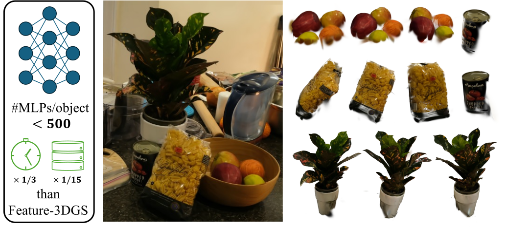

<div align="center">

# MLP Splatting

### Object-Centric Neural Fields

Compact neural primitives for rendering, scene decomposition, and feature-aware interaction.

[Paper](https://arxiv.org/abs/2606.03877) ·
[Project page](https://www.shinjeongkim.com/mlp-splatting/) ·
[Interactive demo](https://www.shinjeongkim.com/mlp-splatting/#visualization)



</div>

MLP Splatting represents a scene with spatially localized light-field MLPs.
Each primitive predicts radiance and opacity within an anisotropic Gaussian
support. Optional feature distillation supports open-vocabulary selection,
segmentation, and editing.

This repository provides a tile-based CUDA implementation with training and
evaluation entrypoints for Replica and ScanNet.

## Installation

Requirements: Linux, Python 3.10+, and a CUDA toolkit with `nvcc`.
The supplied Replica configurations require an NVIDIA GPU with compute
capability 8.0 or newer. Install a supported PyTorch release with matching
torchvision. RTX 50-series GPUs require CUDA 12.8 or newer.

```bash
git clone https://github.com/kxhit/mlp-splatting.git
cd mlp-splatting

python -m venv .venv
source .venv/bin/activate
python -m pip install --upgrade pip

# Choose a PyTorch wheel compatible with your driver:
# https://pytorch.org/get-started/locally/
python -m pip install "torch>=2.10.0" "torchvision>=0.25.0"
python -m pip install -r requirements.txt
python -m pip install -e . --no-deps
python scripts/check_install.py
```

The CUDA extension compiles on first use. Set `TORCH_EXTENSIONS_DIR` to
choose its build cache. Install optional evaluation dependencies for LPIPS
and text-based semantic evaluation:

```bash
python -m pip install -r requirements-optional.txt
```

See [SECURITY.md](SECURITY.md) for checkpoint loading guidance.

## Data

Replica and processed ScanNet scenes use the same COLMAP layout:

```text
scene/
├── images/
├── sparse/0/
│   ├── cameras.bin
│   ├── images.bin
│   └── points3D.bin
└── rgb_feature_langseg/         # optional 512D LSeg features
```

RGB filenames must match `images.bin`; feature files must share the RGB stem.
LSeg features support `.pt`, `.npy`, or `.npz` with shape `512 × H × W` or
`H × W × 512` (dictionary/archive key: `feat`). Use `--feature-type lseg`
for feature supervision. With `--factor N` greater than 1, provide pre-resized
images in `images_N/` with unchanged filenames.

### Replica

Download the [Feature-3DGS processed archive](https://drive.google.com/file/d/1sC2ZJUBRHKeWXXVUj7rIBEM-xaibvGw7/view?usp=sharing)
and retain the [Replica dataset](https://github.com/facebookresearch/Replica-Dataset)
terms and citation. The supplied configurations use `llffhold=8`, offset 2,
and exclude `rgb_009.png` in room1 and `rgb_102.png`/`rgb_108.png` in office4
from training only. Original files and the complete test split are retained.

### ScanNet

Use processed scenes such as `sceneXXXX_XX/`, not raw `.sens` files. Pass these
data options to both training and RGB evaluation:

```text
--dataset scannet --data /path/to/ScanNet/sceneXXXX_XX --factor 1
--split-mode scannet_feature3dgs --llffhold 8 --split-test-offset 2
```

All views must share one calibration. For off-center intrinsics, unequal focal
lengths, or `OPENCV` cameras, train with `--camera-mode colmap-native`.

## Training

```bash
python train.py \
  --config configs/replica/room0_lseg.json \
  --data /path/to/Replica/room0 \
  --output outputs/room0
```

Configurations are provided for `room0`, `room1`, `office3`, and `office4`:

```bash
for scene in room0 room1 office3 office4; do
  python train.py \
    --config "configs/replica/${scene}_lseg.json" \
    --data "/path/to/Replica/${scene}" \
    --output "outputs/${scene}"
done
```

The supplied configurations use 60,000 iterations, constant learning rates,
8×8 tiles, four-view mosaics, and 512D LSeg feature
supervision. Model, optimizer, and resolved configuration files are saved in
the output directory. See [configuration details](configs/replica/README.md).

The renderer checks tile and per-pixel capacities before processing records.
The default tile capacity is 1,536; exceeding a capacity raises an error.

## RGB evaluation

```bash
python evaluate.py \
  --config configs/replica/room0_lseg.json \
  --data /path/to/Replica/room0 \
  --checkpoint outputs/room0/scene_epoch_60000.pt \
  --output results/room0.json
```

Evaluation reports per-image and mean PSNR, SSIM, LPIPS, and render timing.
Use `--disable-lpips` to omit LPIPS. Training exclusions do not remove test
views. Command-line values override configuration values; use
`python train.py --help` and `python evaluate.py --help` for available options.

## Semantic evaluation

Use label maps, a label list, and text embeddings from the same semantic
embedding model as the supervised features:

```bash
python scannet/eval_lseg_table2.py \
  --data_dir /path/to/Replica/room0 \
  --scene_ckpt outputs/room0/scene_epoch_60000.pt \
  --factor 1 \
  --gt_mode semantic_png \
  --gt_semantic_dir /path/to/labels \
  --labels_file /path/to/labels.txt \
  --text_feature_pt /path/to/text_features.pt \
  --tile_order tilecenter \
  --tile_size 8 \
  --score_threshold 5e-3 \
  --save_json results/room0_semantics.json
```

Label maps and model-specific text embeddings are not bundled. Scores against
teacher-generated label maps measure agreement with that teacher.

## Repository layout

```text
train.py             training entrypoint
evaluate.py          RGB evaluation entrypoint
configs/replica/      scene configurations
scannet/             ScanNet loader and shared model, trainer, evaluation
scannet/cuda/         CUDA renderer and training kernels
replica/             Replica loader and launcher
scripts/             installation and package checks
tools/               inference and checkpoint utilities
tests/               CPU and CUDA regression tests
```

## License and citation

Original code is available under the [MIT License](LICENSE). Third-party
components retain their own terms; see [THIRD_PARTY_NOTICES.md](THIRD_PARTY_NOTICES.md).
The code license does not relicense datasets or third-party model weights.

```bibtex
@inproceedings{kim2026mlpsplatting,
  title     = {MLP Splatting: Object-Centric Neural Fields},
  author    = {Kim, Shinjeong and Cheng, Yuzhou and Kong, Xin and Kelly, Paul H. J. and Davison, Andrew J.},
  booktitle = {The European Conference on Computer Vision (ECCV)},
  year      = {2026}
}
```

See [CITATION.cff](CITATION.cff) for citation-manager metadata.
